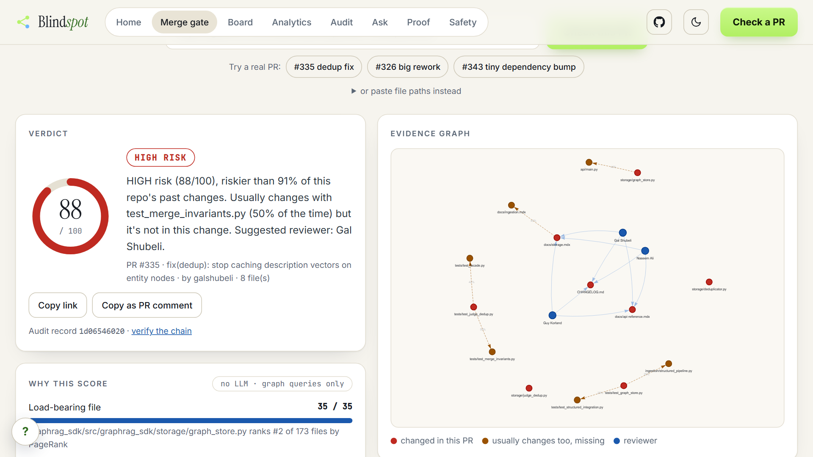
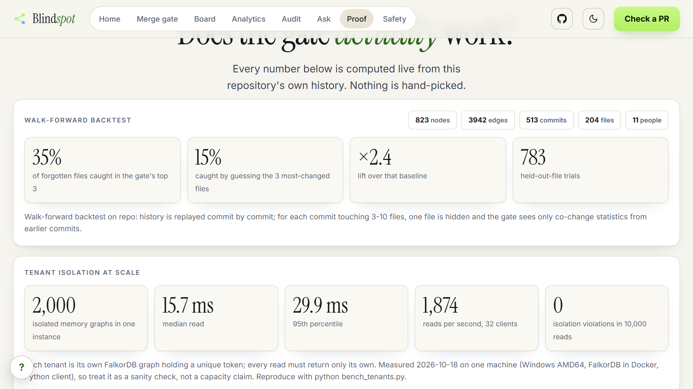
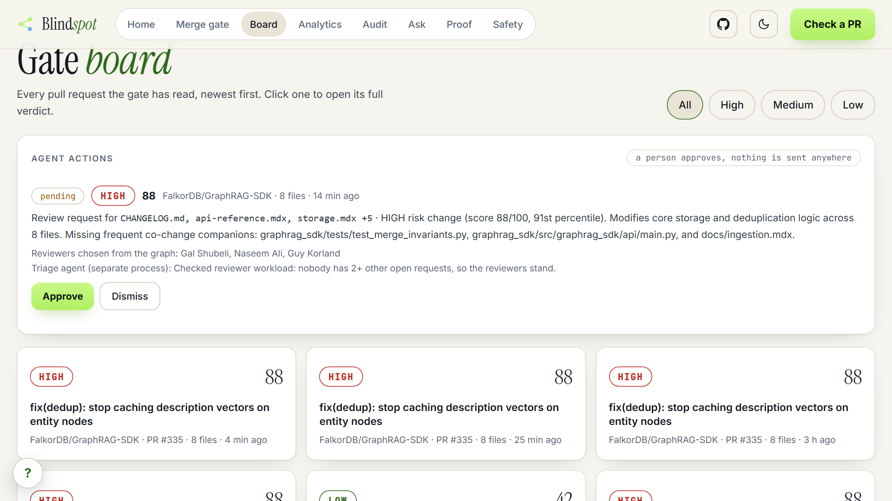
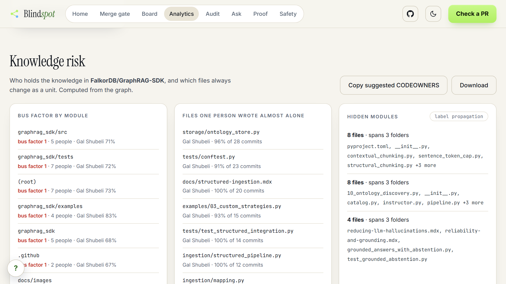

# The File You Forgot to Change

### Building Blindspot: a merge gate that remembers your repository, on FalkorDB

Pull request #335 in FalkorDB's GraphRAG-SDK changed eight files to fix how deduplication cached description vectors. It is a good, small,
well-scoped change. When I ran it through the graph I had built from the repository's history, one line stood out:
`tests/test_merge_invariants.py` had changed together with `tests/test_judge_dedup.py` in 6 of 12 commits, and it was not in this pull request.

That does not mean the PR was wrong. It means a reviewer should ask one question before approving: *did we mean to leave that out?*
Nobody can ask that question from a diff, because a diff only shows what changed. This post is about building the tool that asks it.



## The problem is memory, not diffs

Every merge is a bet that someone remembered everything the change touches: the test that always moves with this module, the person
who actually understands it, the reason a strange-looking line exists. That knowledge lives in the history of the repository, spread
across hundreds of commits. Code review tools show the present. Nobody shows the pattern.

So the goal for the hackathon was narrow: paste a pull request, and get back

- what this change usually drags along that is missing,
- who should review it, chosen by who actually wrote the code,
- why the code looks the way it does, with the commit that explains it,
- and a risk verdict where every point has a stated reason.

## A repository's history is already a graph

People author commits, commits touch files, commits belong to pull requests, files live in modules. That is a graph, and FalkorDB stores
it directly. Ingestion only reads `git log` and `git ls-tree` from a blobless clone, so no code from the repository is ever checked out or run.

```
(Person)-[:AUTHORED]->(Commit {seq})-[:TOUCHED]->(File)-[:IN_MODULE]->(Module)
(Commit)-[:PART_OF]->(PR)
(File)-[:CO_CHANGED_WITH {weight}]->(File)   // derived: changed in the same commit at least 3 times
```

That last edge does most of the work. Once "these two files change together" is an edge, the core question becomes a one-hop query:

```cypher
MATCH (f:File)-[e:CO_CHANGED_WITH]->(o:File)
WHERE f.path IN $files AND NOT o.path IN $files
RETURN o.path, e.weight
```

On GraphRAG-SDK that is 513 commits, 204 files and 3,942 relationships. Everything below runs on that graph, and the gate itself uses
no language model at all: its answers come from graph queries that finish in milliseconds and give the same result twice.

## The first score flagged everything

My first risk score added four parts: how load-bearing the touched files are (PageRank over the co-change graph, up to 35 points),
missing companions (40), how many modules the change spans (10), and size (15). Then I set fixed thresholds: 60 and above is HIGH.

I ran it on twelve real, merged pull requests. **Nine came back HIGH.** A gate that calls almost everything high risk is a gate people
learn to ignore. The scores were fine; the thresholds were mine, picked by eye.

The fix was to stop asking "is 88 high?" and ask "high compared to what?" Blindspot now scores 200 recent commits of the same
repository with the same function and places each new change in that distribution. A verdict reads "riskier than 91% of this
repository's past changes", which is a sentence a reviewer can act on. The same change on a different repository can earn a different
verdict, which is correct: a 40-file refactor means something different in a monorepo than in a library.

One more embarrassment from this stage: `CHANGELOG.md` ranked as the second most load-bearing file in the repository. It does co-change
with everything, because every release touches it. Documentation and lockfiles are now excluded from the "load-bearing" signal. A tiny
dependency bump went from MEDIUM to LOW after that, which is where it belonged.

## My first backtest cheated

Claims like "it finds forgotten files" need a number, so I wrote a test: for every past commit that touched 3 to 10 files, hide one file,
show the gate the rest, and check whether the hidden file appears in its top three suggestions.

The first version said **48%**. It was wrong. It used co-change statistics from the whole history, including commits that happened
after the one being tested, so the gate was partly seeing the future. I replaced it with a walk-forward version that replays history in
order and only lets the gate see earlier commits.

| Repository | Trials | Gate, top 3 | Guessing the 3 most-changed files | Lift |
|---|---|---|---|---|
| FalkorDB/GraphRAG-SDK (513 commits) | 783 | 35% | about 14-15% | about ×2.4 |
| FalkorDB/falkordb-py (330 commits) | 113 | 20% | 18% | ×1.2 |

The honest reading: the signal is useful on a large, active repository and weak on a small one. The Proof page in the app shows these
numbers live, including the weak one. A separate check compares the graph's answers with `git` itself (top author per file and
co-change counts) and agrees on 10 of 10 in both repositories.



## An agent that can only ask

The Track 1 brief asks for an agent that acts on connected data. The interesting design question was what "act" should mean when the
action is about other people's time.

Blindspot's agent has eleven graph tools, and it discovers them over MCP: the app starts its own MCP server, lists the tools, and passes
them to the model. The model chooses tools and fills typed arguments; it never writes Cypher. The repository the tools run against is
injected by the client and hidden from the model, so a prompt cannot point a tool at another tenant's data.

When someone describes a change, the agent calls `gate_change`. If the verdict is MEDIUM or HIGH, it calls `request_review`, which
**queues** a review request with reviewers chosen from who wrote those files. It cannot approve anything. A person approves or dismisses it
on the Board, and nothing is sent outside the app.

The run I trust most is the one where the agent did nothing. Asked about a three-file change that the graph placed at the 36th percentile,
it reported LOW risk and queued no request. On the eight files from PR #335 it reported HIGH (88/100), named three reviewers, and queued
one request for a human to approve.

A second agent runs as a separate process. It watches the queued requests in the graph, counts how many other open requests each suggested
reviewer already has, and rebalances if someone is overloaded, writing its note back to the same record. The two agents never call each
other. They coordinate only through FalkorDB. (This one is rule-based, not a language model, and the README says so.)



## Memory that stays in its own lane

Each user gets their own FalkorDB graph for memory: episodes (what they asked), facts (what they care about), and procedures (which tool
plan worked for each kind of question, so the next session starts from it). FalkorDB holding many isolated graphs in one instance is what
makes this cheap: tenant isolation is a graph name, not a filter someone can forget.

I wanted a number for that, so a benchmark creates 2,000 memory graphs, each holding a unique token, and reads them 10,000 times from 32
parallel clients, checking that every answer contains only its own tenant's token. Median read 15.7 ms, 95th percentile 29.9 ms, and zero
isolation violations. It ran on one machine with a Python client, so treat it as a sanity check, not a capacity claim.

**The bug that passed every test** was here too. The agent streams its steps to the browser, and the web server resumes that stream on
different threads. The "which repository am I in" setting lived in a context variable set at the start of the request, and later steps ran
on threads that never saw it. When I added a second repository, the agent quietly answered questions about the wrong graph. Every unit
test passed, because each test ran on one thread. The fix was to set the repository right before each tool call, and a regression test
now runs tools against two repositories back to back.

## What the graph found that I did not expect

Two views came almost for free once the graph existed.

**Bus factor.** For each module, the fewest people who together wrote half of its history. On GraphRAG-SDK nearly every module has a bus
factor of one. That is not a criticism of the project; it is the normal state of a young library, and it is exactly what a new contributor
or a manager would want to see. Blindspot also turns it into a suggested `CODEOWNERS` file.

**Hidden modules.** FalkorDB's `algo.labelPropagation` over the co-change edges finds communities: groups of files that change as a unit.
The largest community holds 88 files connected through hub files and tells you little, so it is skipped. What remains is interesting: three
groups that cross folders, for example documentation pages, an example script and its test that always move together.



## What the evidence supports today

- Co-change is a statistical signal, not a dependency analysis. It cannot see a dependency that has never changed together.
- It is weak on small or young repositories (×1.2 on a 330-commit repository).
- The demo pull requests are already merged, so their own commits are part of the history the gate reads.
- "Why" comes from commit messages only. Pull request comments, issues and docs are not ingested yet.
- The agent acts only inside the app: it queues, a person approves. It does not post to GitHub.
- The verdict thresholds (HIGH above the 80th percentile of the repository's own history) are a heuristic, not calibrated against incidents.

## Three things I would tell myself on day one

1. **Test the measurement before trusting the number.** The 48% that became 35% was the most valuable bug in the project.
2. **Make the score relative.** An absolute threshold encodes the author's taste; a percentile against the repository's own history
   encodes the repository's.
3. **Let the agent ask instead of act.** A queued request with evidence and a human approval is a stronger demo than an action you cannot
   take back, and it is a design you can defend.

## Try it

- Code (MIT): https://github.com/aadityaa0523/Blind-Spot
- Demo video: https://youtu.be/WgIX5cI3trc
- Live app:https://blind-spot-1.onrender.com

Built for the WeMakeDevs × FalkorDB Graph Hacks (Tracks 1, 2 and 3), using FalkorDB for the repository graph, the per-user memory graphs,
the audit trail and the agent coordination. Built with the assistance of an AI coding assistant; I reviewed, ran and am responsible for the code.

One question I am still thinking about: if a file has changed alongside yours in half of its commits, and this time it did not, whose job
is it to notice?
